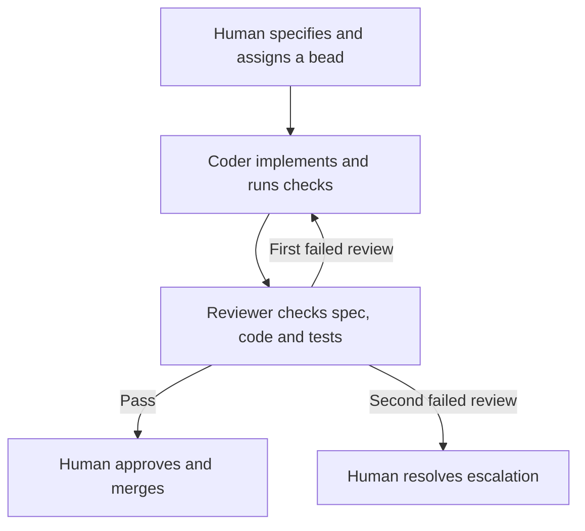

# loop-engineering

**Specify interactively. Implement headlessly.**

loop-engineering runs a coder and a reviewer through a queue of small, specified tasks. You work with an interactive agent to define the work, answer questions and set dependencies. The agents then implement and review it in headless sessions—sessions that run without you answering prompts.

[Beads](https://github.com/gastownhall/beads) holds the task graph, specifications and handoff history. A shell loop starts fresh agent sessions, with the role prompts directing each session to work on one bead. By default, reviewed work reaches you as a pull request to approve and merge.

The coder runs on [Claude Code](https://claude.com/claude-code). The reviewer can run on Claude Code or [Codex](https://github.com/openai/codex).

## Why this exists

A large specification can outlast an agent's conversation. Decisions become harder to recover as context fills, and compaction can lose details.

This workflow puts the specification and progress in records that the next session can read:

- **Small tasks with explicit dependencies.** Each bead describes one implementation step. A dependent bead becomes ready only after its blockers close, which happens after their code reaches `main`.
- **Fresh sessions with saved state.** Each session reads its bead, role prompt, project configuration and repository. Checkpoint commits and append-only bead notes let later sessions resume work.
- **A separate review role.** The reviewer checks the implementation against the same specification, runs a code review and reruns the project's required checks.
- **A record of the reasoning.** Beads retain requirements, constraints, review findings and disputes. Commit messages include bead IDs, so later work can trace code back to its specification.

Small beads reduce reliance on conversation history. The runner does not enforce a context budget or prevent compaction, and recovery depends on what a previous session saved.

## The workflow

The human owns the specification, initial assignment and escalations. In the default `pr` mode, the human also owns the merge.

| Role | Runs on | Responsibility |
| --- | --- | --- |
| Human + interactive agent | An interactive Claude Code or Codex session | Break the specification into beads, resolve open questions and approve the task graph. |
| Coder (Ralph by default) | Headless Claude Code | Implement one bead test-first, run `/simplify` and the project checks, open or update its PR, and hand it to the reviewer. |
| Reviewer (Alice by default) | Headless Claude Code or Codex | Check the branch against the bead's specification, review the code and rerun the checks. Pass, return or escalate the bead. |
| Human | You | Assign specified work, handle reviewed PRs and settle escalations. |



The diagram shows the default `pr` mode. In `local` mode, the reviewer merges passing work and the human accepts it afterward.

Each agent has its own Git worktree: a separate checkout sharing the repository's Git history. Both loops use the same `run.sh`, with different names and role prompts. Changing a bead's assignee hands it to the next role; the notes carry the context.

The reviewer returns blocking findings to the coder once. A second failed review goes to the human. A rebase does not count as another review round. Non-blocking findings are recorded for human triage.

See the [operating guide](loop/README.md#rules-of-engagement) and [reviewer prompt](loop/REVIEWER.md) for the full review protocol.

## Requirements and scope

The runner is reusable across projects. **The supplied setup skill bootstraps a Python project using uv, Ruff and pytest**, with the primary checkout on `main`. Adapting another stack requires configuring its project facts and validation commands.

Every project needs:

| Tool | Used for |
| --- | --- |
| [Claude Code](https://claude.com/claude-code), authenticated | The coder, the default reviewer and the setup skill. |
| [Beads](https://github.com/gastownhall/beads) (`bd`), installed system-wide | Task state, dependencies and handoffs. |
| Git, with a commit name and email configured | Branches, worktrees and checkpoints. |
| [uv](https://docs.astral.sh/uv/) | Python setup, project checks and the watcher. |
| `jq` | Reading JSON in the runner and setup scripts. |

The coder's Claude Code session needs `/simplify`. A Claude Code reviewer also needs `/code-review`; a Codex reviewer uses `codex exec review`.

Additional tools depend on your setup:

| Tool | When needed |
| --- | --- |
| [GitHub CLI](https://cli.github.com/) (`gh`), authenticated, and a GitHub `origin` remote | `pr` mode. The active account must be able to open PRs. |
| [Codex](https://github.com/openai/codex), authenticated | A Codex reviewer. Before its first headless run, open Codex in the primary checkout, trust the project and approve its hooks. |
| [herdr](https://herdr.dev/) | The setup skill's automatic terminal layout. Without it, start the loops and watchers [manually](loop/README.md#running). |
| GNU `timeout` or `gtimeout` | Session time limits. On macOS: `brew install coreutils`. Without it, sessions have no time limit. |

The watcher requires Python 3.13 or later and Rich. Running `uv run ralph/watch.py` supplies its script dependencies.

## Get started

### 1. Install the setup skill

Clone this repository, then link its skill into Claude Code:

```bash
git clone https://github.com/rbastian/loop-engineering.git
cd loop-engineering
mkdir -p ~/.claude/skills
ln -s "$(pwd)/skills/dev-env-setup" ~/.claude/skills/dev-env-setup
```

The skill finds `loop/` relative to its own directory. Keep the clone at that location while the link is in use.

### 2. Set up the target project

In an interactive Claude Code session in your target project, inside herdr, run:

```text
/dev-env-setup
```

The skill asks for the bead prefix, ship mode, human assignee, agent names and reviewer engine. It configures Git, uv and Beads, installs the harness as `ralph/`, creates the agent worktrees and starts the loops and watchers. The loops wait until you assign work.

**Before running setup:** bootstrap adds Python development dependencies and runs formatting and lint fixes. The worktree script stages and commits all current changes; in `pr` mode, it also pushes `main` to `origin`. Run it only with changes you intend to include.

For manual installation, see [Install in a project](loop/README.md#install-in-a-project).

### 3. Turn a specification into beads

Open an interactive Claude Code or Codex session in the target project. Start with a document or a description of what you want to build:

> Read the specification in `<file>` (or: here is what I want to build: ...). Break it into beads. Create one epic for the whole specification. Under it, create one child bead per implementation step, small enough for one coding session. Give each child a description, a design and acceptance criteria. Add a dependency wherever one step needs another step's code first. Before you create anything, ask me about each gap in the specification. Do not assign any bead. When you finish, show me the graph.

Review the graph before implementation. Each bead needs enough context to implement independently, including requirements, acceptance criteria and constraints the change must preserve. The prompts call these constraints the **trap list**.

Useful commands:

```bash
bd graph <epic-id>
bd ready
bd show <id>
```

### 4. Resolve questions before assigning work

For the first ready bead, enter this in your interactive session:

> Read bead `<id>`. Ask me questions about the spec, one round at a time, until you have no questions left. Then update the bead's design field with the final spec.

This is the **spec ritual**. The coder implements against that design; the reviewer checks against it. Each question answered here removes a decision the headless coder would otherwise have to guess.

Then assign the bead:

```bash
bd update <id> --assignee=Ralph
```

Use your configured coder name if you changed the default. Repeat the spec ritual before assigning each new bead.

### 5. Review and merge

In `pr` mode, a bead labelled `merge` has a reviewed PR waiting for you. Inspect the PR and review findings, approve and merge it, then close the bead:

```bash
bd close <id>
```

Remove its `merge` label afterward. **Close the bead only after its code is on `main`**, so dependent work starts against merged code.

The reviewer posts a PR comment rather than a GitHub approval. Agents often use the human's GitHub account, and an account cannot approve its own PR.

## Ship modes and human queues

Set the mode in `ralph/project.md`.

| Mode | After review passes | Human queue |
| --- | --- | --- |
| `pr` (default) | The reviewer hands the PR to the human for approval and merge. The human closes the bead after merging. Use this for shared repositories. | `merge` |
| `local` | The reviewer merges into `main` in the primary checkout, closes the bead and assigns it to the human for acceptance. Intended for single-user repositories; no remote is required. | `accept` |

In either mode, a second failed review adds `escalated` and assigns the unmerged bead to the human.

In `local` mode, the reviewer waits for the primary checkout to be on `main` with no modified or staged tracked files before merging. See [Rules of engagement](loop/README.md#rules-of-engagement) for queue handling and merge preconditions.

## What's in this repository

| Path | Purpose |
| --- | --- |
| [`loop/`](loop/) | Reusable source: runner, coder and reviewer prompts, project template, watcher and tests. |
| [`skills/dev-env-setup/`](skills/dev-env-setup/) | Claude Code setup skill and scripts that install the harness into a target project. |
| [`ralph/`](ralph/) | This repository's installed harness. The repository runs its own loop; reusable harness changes belong in `loop/` or `skills/`. |

An installed project's `ralph/project.md` holds its agent names, paths, ship mode, reviewer engine, stack and **gate**—the required validation command. The default gate checks Ruff formatting, Ruff lint and pytest. The runner appends this configuration to each role prompt at the start of every session.

Agent names are configurable. `RALPH_ENGINE` selects the CLI for a loop; `RALPH_MODEL` selects its model. The coder stays on Claude Code because its prompt uses `/simplify`.

## Operating the loop

The [operating guide](loop/README.md) covers:

- [Starting loops and watchers](loop/README.md#running), including engine, model, log and timeout settings.
- [Session cost notes](loop/README.md#cost-notes). With stream logging enabled, the runner appends available cost and token information to the bead after a completed session. Claude's dollar figure is an API-equivalent estimate, not a bill.
- [Stopping, restarting and recovering sessions](loop/README.md#stop-and-restart).
- [Updating an installed harness](loop/README.md#update-an-installed-harness). Bootstrap preserves existing harness files and does not upgrade them; rerunning it can still change project dependencies and formatting.
- [Adding another agent role](loop/README.md#add-an-agent).

## Safety

Headless sessions bypass permission prompts: Claude Code uses `--dangerously-skip-permissions`, and Codex uses `--dangerously-bypass-approvals-and-sandbox`. Each agent needs its own worktree and narrowly scoped credentials.

In `pr` mode, the human controls every merge. In `local` mode, the reviewer and gate are the checks before code reaches `main`. Use that mode only where you accept automated merges.

## Contributing

Keep documentation aligned with the scripts and role prompts. Reusable harness changes belong in `loop/` or `skills/`; `ralph/` is the installed copy.

See [Tests](loop/README.md#tests) for the test command. For documentation changes, verify the commands, links and workflow descriptions against the implementation.

## Sources and history

Two writeups shaped this workflow:

- Steve Yegge, [Introducing Beads](https://steve-yegge.medium.com/introducing-beads-a-coding-agent-memory-system-637d7d92514a): a dependency graph and persistent task records that agents can query across sessions.
- Geoffrey Huntley, [everything is a ralph loop](https://ghuntley.com/loop/): fresh iterations, with engineering effort spent observing the loop and removing recurring failures.

The original single-agent runner and AI Guild demo material are in commit [`194238a`](https://github.com/rbastian/loop-engineering/tree/194238a). Claude Code reviewed and hardened later versions; the commit history records the fixes.

